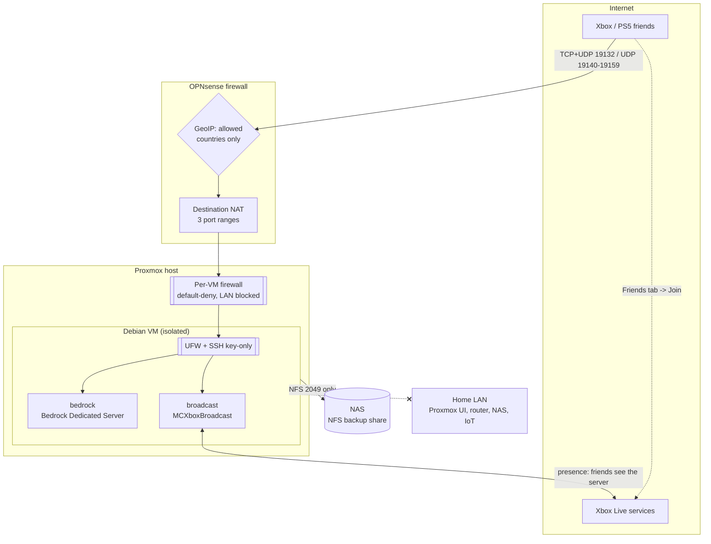

# Self-Hosted Minecraft Bedrock Server: A Secure Homelab Build

A self-hosted Minecraft Bedrock server that friends on **Xbox and PlayStation 5** can join, running in a hardened, isolated VM on a **Proxmox** host behind an **OPNsense** firewall.

It has **no monthly cost** and **no third-party tunnel**. It was built security-first, as a defense-in-depth exercise.

**Status:** live since October 2026, with friends playing from Xbox and PS5.

> **Why this project:** consoles can't type in a server address, and as of 2026 Bedrock only accepts its newer **NetherNet** connections. That broke the usual "free tunnel" approach, so I had to expose the server to the internet myself. I treated it the way I'd treat any internet-facing service: assume it will be attacked, limit who can reach it, limit what it can reach, and make sure the data survives anything.

---

## At a glance

| Area | Details |
|---|---|
| **Hypervisor** | Proxmox VE on a rack server (ZFS storage) |
| **Firewall / router** | OPNsense (GeoIP filtering, destination NAT, DNS reservations) |
| **Guest OS** | Debian (minimal, no desktop) |
| **Workloads** | Docker Compose: Bedrock Dedicated Server + MCXboxBroadcast (console discovery) |
| **Clients** | Xbox, PS5 (cross-play through Microsoft accounts) |
| **Backups** | Live hot-backups every 2 h, nightly full backups, NAS copies, weekly whole-VM backups |
| **Cost** | $0/month |

## Architecture



**How a console joins:**

1. A bot Xbox account (run by MCXboxBroadcast) is always "online, playing Minecraft". This is what makes the server appear in friends' Friends tab, because consoles have no "Add Server" box.
2. The friend clicks join. Xbox Live hands them the server's public address.
3. The connection passes GeoIP, then NAT, the Proxmox VM firewall and UFW, and reaches the server.
4. The server checks their Xbox Live identity against the **allowlist** before letting them in.

## Security highlights

This is the core of the project. Full detail is in **[docs/security.md](docs/security.md)**.

| Layer | Control |
|---|---|
| Perimeter | Only 3 port ranges forwarded. **GeoIP alias** (MaxMind GeoLite2) limits them to allowed countries |
| Authentication | Xbox Live sign-in enforced (`online-mode`), so identities can't be faked |
| Authorization | **Allowlist**: only approved gamertags can join |
| Least privilege | Members only, cheats off, **zero in-game operators**. Admin happens only from the VM shell |
| Discovery control | The bot only shows the server to friends the admin approves (`auto-friend: false`) |
| Segmentation | Proxmox per-VM firewall **blocks the VM from the entire home network**, except one NFS port to the NAS |
| Host hardening | Minimal Debian, SSH **key-only** from the LAN, UFW default-deny, unattended security updates |
| Container hardening | Non-root processes, `no-new-privileges`, one narrowly scoped capability, log rotation |
| Management | Container dashboard (Portainer agent) reachable **only from one admin VM**, enforced by the hypervisor firewall |
| Resilience | Consistent live backups (Bedrock's hot-backup API), off-VM copies, VM-level backups, clean-shutdown tuning |
| Secrets hygiene | `.env`, tokens, keys and world data are git-ignored; every IP and identifier in this repo is a placeholder |

## Problems I hit and how I solved them

Real-world troubleshooting is most of what this build was. Full write-ups are in **[docs/troubleshooting.md](docs/troubleshooting.md)**.

- **The free tunnel stopped working.** Bedrock 1.26.51+ is NetherNet-only, and the tunnel's free tier only carries the older RakNet protocol. I switched to port forwarding, then added GeoIP and segmentation to make up for the larger exposure.
- **A hidden double NAT.** The firewall's WAN had a private address the whole time. The ISP gateway's IP Passthrough was bound to the NIC's hardware MAC, but the firewall was using a spoofed MAC left over from an old failover setup.
- **A health check that lied.** The container reported "unhealthy" around the clock, because its probe uses RakNet and the server no longer answers it.
- **Container permission puzzles.** One image runs as UID 1001, not 1000. Another needed a single Linux capability so the admin tool could find the server process after its privilege drop.
- **Locking myself out safely.** Every firewall change was applied with an automatic 10-minute rollback, cancelled only after I'd proved access still worked.
- **A WAN that quietly went private.** Correlating firewall and server logs showed the WAN had briefly taken a private lease after a gateway hiccup, which disabled the port forwards. One obvious fix cut the connection entirely and was reverted; the safe fix is shorter gateway leases.
- **Off-VM backups that hung.** The NFS mount stalled because the VM's default-deny firewall had no exception for the NAS yet: proof the segmentation works. One ordered rule fixed it.
- **A bot that befriended strangers.** A separate auto-accept setting was switched on; I found it by reading the live config file.

## Known limitations

- **iPhone and iPad can't join.** This is a Mojang bug with the new NetherNet connection type on iOS, not something this setup can fix. Xbox, PS5, Windows and Android work.
- **Console players need their platform's online subscription:** PS Plus (Essential is enough) on PS5, Game Pass Essential on Xbox. Everyone needs a free Microsoft account.
- **Discovery depends on one bot Xbox account.** If Microsoft flags it, the server keeps running but disappears from Friends tabs until the bot is relinked.

## Repository layout

```
server/
  docker-compose.yml        Bedrock server + console broadcaster, hardened
  .env.example              Settings template (copy to .env; never committed)
  setup-vm.sh               One-time VM prep: Docker, UFW, SSH hardening, clean-shutdown tuning
  proxmox-vm-firewall.fw    Per-VM firewall: default-deny in, home network blocked out
  mc                        Admin helper: allow/deny/kick/say/logs/status/backup/update
  snapshot.sh               Live hot-backup (no downtime) using save hold/query/resume
  backup.sh                 Nightly full backup with in-game warning
  ipwatch.sh                Follows a changing public IP (two-source check, warned restart)
  KIT.md                    Quick reference for the kit
docs/
  security.md               Threat model, controls, verification, trade-offs
  troubleshooting.md        Problem -> cause -> fix log
  operations.md             Day-to-day admin, backups, restore, updates
screenshots/                Redacted screenshots
```

## Skills demonstrated

- **Network security:** perimeter filtering, GeoIP, NAT design, diagnosing double NAT, segmentation with a host-enforced firewall
- **Systems:** Proxmox VM sizing (NUMA, CPU type, virtio multiqueue, IO threads), Debian administration, systemd, cron, NFS
- **Containers:** Docker Compose, Linux capabilities, UID mapping, health checks, host vs. bridge networking
- **Identity and access:** allowlisting, enforced federated identity (Xbox Live), least-privilege admin model
- **Resilience:** consistent hot backups, retention policies, off-host copies, VM snapshots vs. backups
- **Troubleshooting:** packet captures and live firewall logs, protocol changes, permission errors, reading stack traces

These map closely to CompTIA Security+ domains: security architecture (segmentation, defense in depth), security operations (hardening, backups, monitoring) and threats and mitigations (attack surface reduction).

## Roadmap

- [ ] Centralized log monitoring and alerting for the VM and firewall
- [ ] Further network segmentation for internet-facing services
- [x] LAN-only container management dashboard (Portainer agent, one admin VM only)
- [ ] Uptime monitoring with alerts (e.g. Uptime Kuma)
- [x] Automate the public-IP update if the ISP changes it (`ipwatch.sh`)

## Credits

- [itzg/minecraft-bedrock-server](https://github.com/itzg/docker-minecraft-bedrock-server)
- [MCXboxBroadcast](https://github.com/MCXboxBroadcast/Broadcaster)
- [MaxMind GeoLite2](https://dev.maxmind.com/geoip/geolite2-free-geolocation-data)

*Minecraft is a trademark of Mojang/Microsoft. This is a personal, non-commercial homelab project.*
